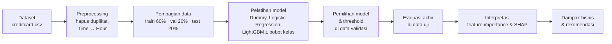

# Deteksi Transaksi Fraud Bank dengan LightGBM

**Case Method — Mata Kuliah Data Mining**
Ghazi Fahmi Ramadhan (L0124130) · Informatika, Fakultas Teknologi Informasi dan Sains Data, Universitas Sebelas Maret

Program ini membangun model **LightGBM** untuk mendeteksi transaksi kartu kredit palsu (*fraud*). Tantangan utamanya adalah data yang sangat tidak seimbang: hanya sekitar 0,17% transaksi yang merupakan fraud. Program juga membandingkan LightGBM dengan model lain, mencari fitur yang paling berpengaruh, dan menghitung dampak finansialnya bagi bank.

## Hasil utama

| Ukuran | Nilai |
|---|---|
| Model terpilih | LightGBM tanpa bobot kelas, threshold 0,10 |
| Fraud yang tertangkap (recall) | **81,1%** (77 dari 95 transaksi) |
| Ketepatan peringatan (precision) | **85,6%** |
| PR-AUC | **0,836** (Logistic Regression: 0,733) |
| Nominal kerugian yang dicegah | **63,8%** |
| Transaksi normal yang ikut ditandai | 13 dari 56.651 (0,023%) |

## Dataset

[Credit Card Fraud Detection](https://www.kaggle.com/datasets/mlg-ulb/creditcardfraud) dari Machine Learning Group, Université Libre de Bruxelles (ULB). Dataset berisi 284.807 transaksi kartu kredit nasabah Eropa selama dua hari pada September 2013, dengan 492 transaksi fraud.

| Fitur | Keterangan |
|---|---|
| `Time` | Detik sejak transaksi pertama |
| `V1`–`V28` | Hasil transformasi PCA (makna aslinya dirahasiakan) |
| `Amount` | Nominal transaksi |
| `Class` | Label: 1 = fraud, 0 = normal |

> Dataset **tidak disertakan** di repository ini karena ukurannya (±150 MB) melebihi batas file GitHub (100 MB). Unduh `creditcard.csv` dari link Kaggle di atas.


## Alur program



1. **Preprocessing.** Menghapus 1.081 baris duplikat, lalu mengubah `Time` menjadi jam transaksi (`Hour`, 0–23).
2. **Pembagian data.** Data dibagi secara *stratified* agar proporsi fraud sama di setiap bagian: train 60%, validation 20%, test 20%.
3. **Pelatihan model.** Empat model dilatih:
   - *Dummy*: selalu menebak "normal", untuk membuktikan bahwa akurasi menyesatkan
   - *Logistic Regression* dengan bobot kelas seimbang
   - *LightGBM tanpa bobot kelas*
   - *LightGBM dengan `scale_pos_weight`* (bobot kelas fraud = akar rasio normal : fraud)
4. **Pemilihan model dan threshold.** Model dengan PR-AUC tertinggi di data validasi dipilih, lalu threshold dicari dengan memaksimalkan F1-score di data validasi.
5. **Evaluasi.** Model diuji sekali di data uji dengan precision, recall, F1, PR-AUC, dan ROC-AUC.
6. **Interpretasi.** Fitur paling berpengaruh dianalisis dengan *feature importance* (gain) dan SHAP.
7. **Dampak bisnis.** Menghitung nominal fraud yang tertangkap dan yang lolos.

## Pola transaksi fraud

| Nominal transaksi | Persentase fraud per jam |
|---|---|
|  |  |

- Median nominal fraud hanya 9,82, jauh di bawah transaksi normal (22,00). Namun sebagian fraud bernominal besar, sehingga rata-ratanya lebih tinggi (123,87 berbanding 88,41).
- Persentase fraud tertinggi terjadi pada jam ke-2 (1,45%), ke-4 (1,04%), dan ke-3 (0,49%).

## Perbandingan model

| Model | Precision | Recall | F1 | PR-AUC |
|---|---|---|---|---|
| Dummy (selalu normal) | 0,000 | 0,000 | 0,000 | 0,002 |
| Logistic Regression | 0,058 | 0,905 | 0,109 | 0,733 |
| LightGBM tanpa bobot | 0,960 | 0,758 | 0,847 | 0,836 |
| LightGBM + `scale_pos_weight` | 0,904 | 0,789 | 0,843 | 0,844 |

*Data uji, threshold 0,5.* Model Dummy memperoleh akurasi 99,83% tanpa menangkap satu pun fraud, sehingga akurasi tidak dipakai sebagai ukuran. Logistic Regression menangkap banyak fraud, tetapi sekitar 94 dari setiap 100 peringatannya salah.

| Confusion matrix (threshold 0,10) | Kurva precision–recall |
|---|---|
|  |  |

## Faktor paling berpengaruh

| Feature importance (gain) | SHAP |
|---|---|
|  |  |

- **V14** adalah fitur paling dominan, dengan gain lebih dari tiga kali lipat fitur kedua.
- Nilai **V14, V12, dan V10 yang rendah** serta **V4 yang tinggi** meningkatkan peluang fraud.
- Karena `V1`–`V28` hasil PCA, arti bisnis fitur-fitur ini tidak dapat dijelaskan.

## Dampak bisnis

Model mencegah **63,8% nominal kerugian** di data uji. Angka ini lebih rendah dari recall (81,1%) karena fraud yang lolos cenderung bernominal besar: rata-rata sekitar 261 per transaksi, dibanding sekitar 107 untuk fraud yang tertangkap.

## Struktur repository

```
├── case_method_fraud_lightgbm.ipynb   # notebook program lengkap beserta output
├── hasil/                             # grafik (.png) dan tabel (.csv), dinamai sesuai nomor subbab laporan
└── README.md
```

## Cara menjalankan

1. Unduh `creditcard.csv` dari Kaggle, lalu letakkan satu folder dengan notebook.
2. Buka `case_method_fraud_lightgbm.ipynb` di **Google Colab** atau **Jupyter**.
3. Jika memakai Colab, aktifkan baris `%pip install` di bagian **0. Persiapan**.
4. Jalankan semua sel (*Run all*). Prosesnya sekitar 2–5 menit, dan grafik serta tabel tersimpan otomatis di folder `hasil/`.

Library yang digunakan: `pandas`, `numpy`, `scikit-learn`, `lightgbm`, `shap`, `matplotlib`, `seaborn`.

## Referensi

- Ke, G., dkk. (2017). LightGBM: A highly efficient gradient boosting decision tree. *Advances in Neural Information Processing Systems 30 (NIPS 2017)*.
- Lundberg, S. M., & Lee, S.-I. (2017). A unified approach to interpreting model predictions. *Advances in Neural Information Processing Systems 30 (NIPS 2017)*.
- Dal Pozzolo, A., Caelen, O., Johnson, R. A., & Bontempi, G. (2015). Calibrating probability with undersampling for unbalanced classification. *IEEE SSCI 2015*.
- Saito, T., & Rehmsmeier, M. (2015). The precision-recall plot is more informative than the ROC plot when evaluating binary classifiers on imbalanced datasets. *PLoS ONE, 10*(3), e0118432.
